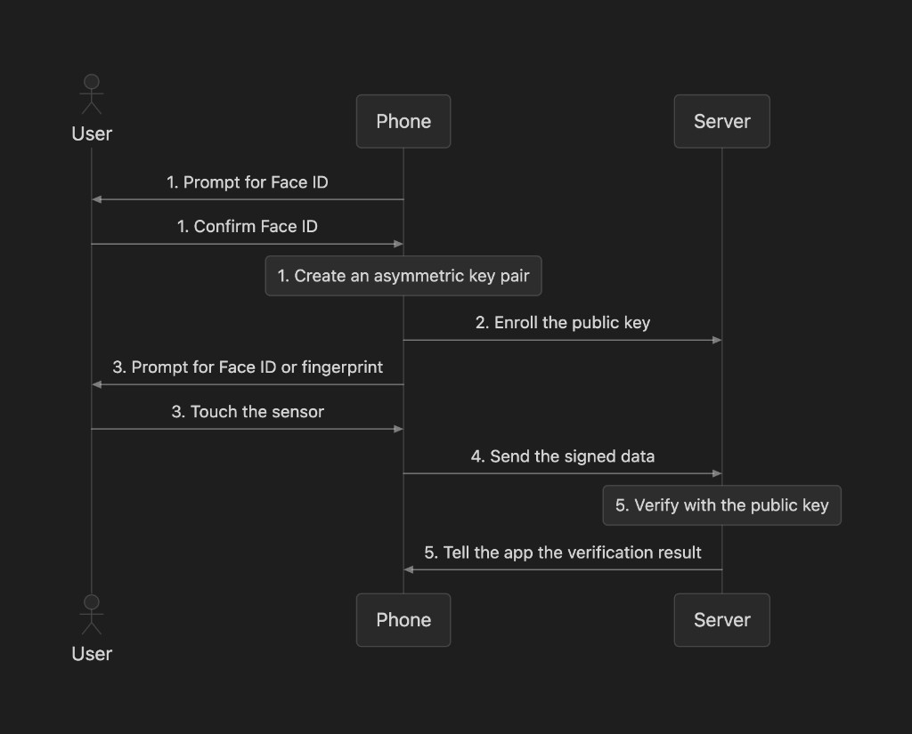

# react-native-device-biometrics

New Architecture-only React Native Turbo Module for RSA 2048 keys in the iOS Keychain and Android Keystore. A key can require Face ID, Touch ID, or a fingerprint, or it can sign silently. Enroll the public key on your server, then verify a signature made on the device.

Keys created with `requireAuthentication: true` stop signing after the user adds or removes a biometric. `createSignature` rejects with `ERROR_KEY_INVALIDATED`. `createKeys` still succeeds so the user can enroll again.

## Requirements

New Architecture only. This package is a codegen Turbo Module and does not include a legacy bridge.

Use React Native 0.76 or newer with the New Architecture enabled, or 0.82 or newer, where the New Architecture is the only architecture. Android `minSdkVersion` must be 24 or higher. iOS needs `NSFaceIDUsageDescription` in `Info.plist`.

## Install

```sh
npm install react-native-device-biometrics
```

```sh
yarn add react-native-device-biometrics
```

```sh
pnpm add react-native-device-biometrics
```

Then install iOS pods:

```sh
cd ios && pod install
```

## Usage

`requireAuthentication` defaults to `true`. `createKeys` prompts for Face ID, Touch ID, or a fingerprint, then stores the key pair. `createSignature` prompts again before signing. Pass `false` to create and sign a silent device key with no prompt.



Pass `keyAlias` to keep a silent `DEVICE` key and a biometric `BIOMETRIC` key. Creating a key replaces only that alias.

Method options, code samples, and error handling are in [examples/usage.md](examples/usage.md).

## Acknowledgements

The public API and the Keychain / Keystore signing approach follow [react-native-biometrics](https://github.com/SelfLender/react-native-biometrics) by Self Lender. Thank you to that project and its maintainers.
